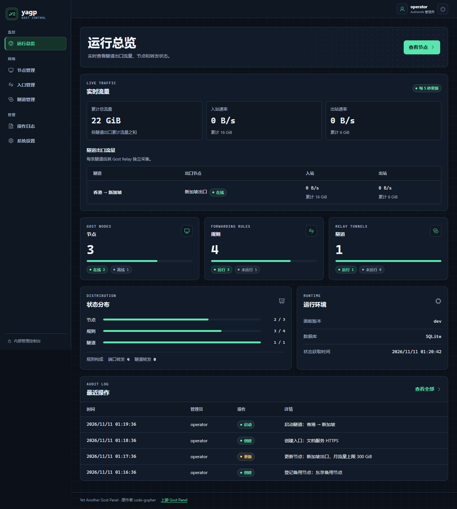
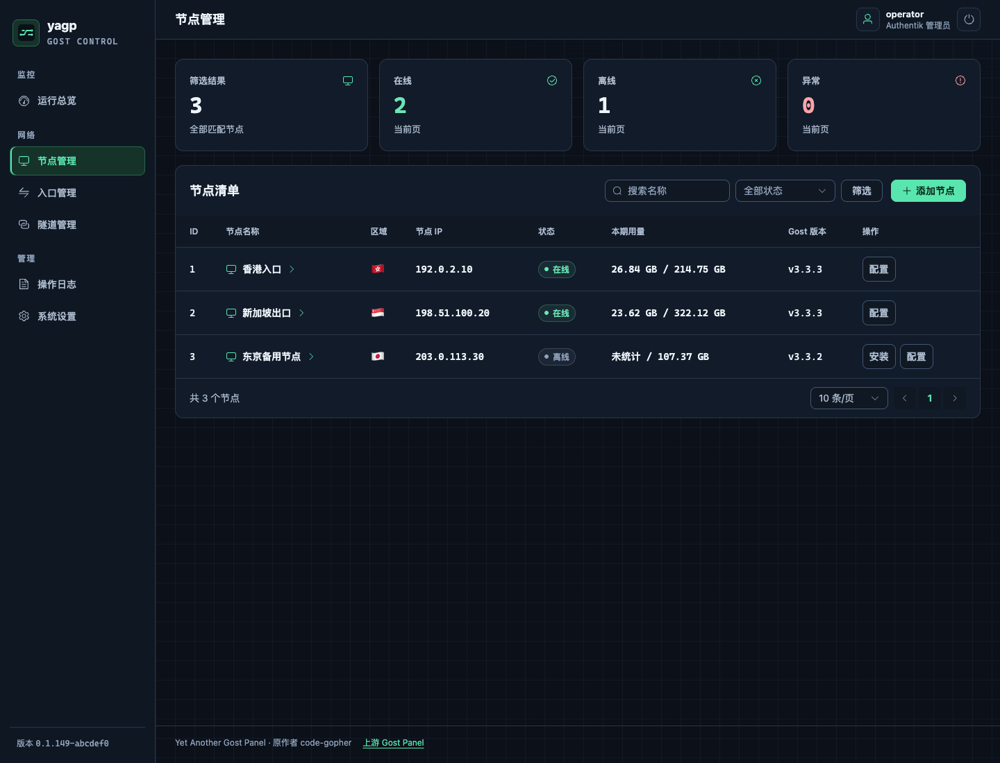
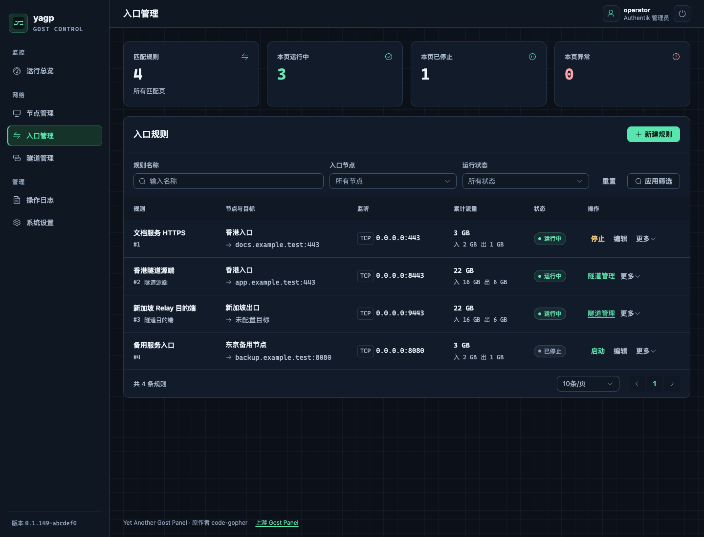
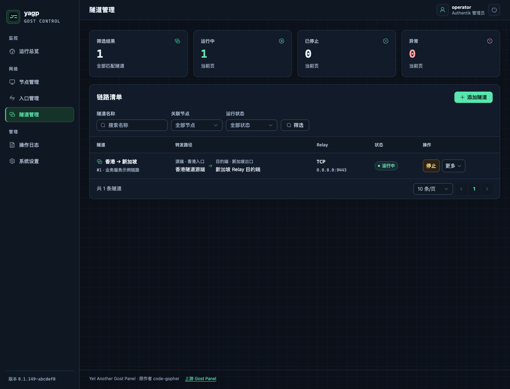

# yagp — Yet Another Gost Panel

<div align="center">

**供管理员集中管理多个 Gost v3 实例的内部面板**

[](./LICENSE)
[](https://www.docker.com/)
[](https://go.dev/)

</div>

yagp 基于原作者 **code-gopher** 开发的 Gost Panel，沿用 MIT 许可证。[上游项目](https://github.com/code-gopher/gostPanel) · [许可证](./LICENSE)

改名、管理员认证、数据库和节点通信改造使用了 OpenAI Codex 辅助。[AGENTS.md](./AGENTS.md)

## 节点一键安装与升级

### 安装新节点

先在面板配置 [TLS 注册和上报](#启用节点注册和流量上报)。在 **节点管理 → 添加节点** 填写节点名称，打开安装窗口并获取一次性令牌。每台 Linux 主机安装一个节点。面板生成的安装命令使用当前面板的发布标签，也可以将下方的 `RELEASE_TAG` 替换为该标签后以 root 身份执行。

把命令中的地址和令牌替换为面板提供的值。令牌有效期为 15 分钟，注册成功后立即失效。重新签发会撤销上一枚未使用的令牌。[节点安装脚本](./scripts/install_node.sh)

```bash
version='RELEASE_TAG'
curl -fsSL "https://raw.githubusercontent.com/hanzec/yagp/refs/tags/${version}/scripts/install_node.sh" \
  | YAGP_DAEMON_VERSION="$version" bash -s -- --host 'panel.example.com' --token 'TOKEN_FROM_PANEL'
```

安装 Gost 及在线升级时按节点的网络出口判断地区。中国大陆、香港和澳门优先通过 gh-fast 下载发布包，代理失败、其他地区或检测失败时使用 GitHub。安装脚本首次拉取 `yagp-daemon` 默认直连。可在管道右侧为 `bash` 设置 `GH_PROXY` 覆盖下载路径，设置 `GH_PROXY=''` 可强制直连。使用只支持文件下载的代理且无法访问 GitHub API 时，可同时设置 `YAGP_GOST_VERSION` 为官方稳定版标签，例如 `v3.3.3`，跳过初装时的 Gost 版本查询。

### 升级已安装节点

从公网 gRPC 迁移到 WebSocket 前，先备份面板数据库和节点配置。更新面板和反向代理后，等节点在面板中显示离线，再为它签发新的注册令牌。在节点主机上以 root 身份执行原地重新注册命令，将 `42` 换成原节点 ID。脚本暂停 `yagp-daemon`，写入新凭据后启动新版守护进程，并保留节点 ID 和 nftables 配置。systemd 服务迁移期间转发会短暂中断。支持 systemd 和 OpenRC。

```bash
version='RELEASE_TAG'
curl -fsSL "https://raw.githubusercontent.com/hanzec/yagp/refs/tags/${version}/scripts/install_node.sh" \
  | YAGP_DAEMON_VERSION="$version" bash -s -- reenroll --node-id 42 --host 'panel.example.com' --token 'TOKEN_FROM_PANEL'
```

迁移完成后，使用 systemd 且系统 D-Bus 可用的节点可通过 `upgrade` 更新 `yagp-daemon`，沿用原配置、凭据和证书。

```bash
version='RELEASE_TAG'
curl -fsSL "https://raw.githubusercontent.com/hanzec/yagp/refs/tags/${version}/scripts/install_node.sh" \
  | YAGP_DAEMON_VERSION="$version" bash -s -- upgrade --node-id 42
```

## 🚀 核心特性

- ⚡ **极简管理** - 统一管理多个 Gost 节点及其转发规则。
- 🔗 **多跳隧道** - 支持复杂的出口/中转隧道配置（入口 -> 出口 -> 目标）。
- 📊 **实时延迟** - 每 5 秒自动检测节点与转发链路的 Ping 值。
- 🛡️ **管理员访问** - 使用 Authentik 正向认证和管理员组，操作日志按管理员用户名记录。
- 📈 **流量统计与配额** - 节点通过加密的 WebSocket 上报流量，可为每个节点单独设置转发流量上限和重置周期。
- 🐳 **快速部署** - 全量支持 Docker 一键运行及 GitHub Action 自动构建。

## 🛠️ 快速开始

### 部署面板

**方式 A · Docker（推荐）**

此方式接入已有的 Traefik（v3.4 或更高版本，启用 Docker provider）和 Authentik Outpost。将面板域名指向 Traefik，并为其配置 HTTPS 证书。Traefik 和面板加入同一个 Docker 网络，Traefik 还须能访问 Outpost 的内部地址。

在本项目根目录创建 `.env`，将域名、网络名和 Outpost 地址换成实际值。Outpost 地址包含协议和端口，末尾不加 `/`；`websecure` 是 Traefik 的 HTTPS 入口名。

```dotenv
YAGP_PUBLIC_HOST=panel.example.com
TRAEFIK_PUBLIC_NETWORK=traefik
TRAEFIK_PUBLIC_HTTPS_ENTRYPOINT=websecure
AUTHENTIK_OUTPOST_URL=http://authentik-server:9000
```

从部署目录启动 Compose 中指定的 [GHCR 镜像](https://github.com/hanzec/yagp/pkgs/container/yagp)。

```bash
docker compose up -d
```

镜像支持 Linux amd64 和 arm64。可以在 `docker-compose.yml` 中将镜像设为 `ghcr.io/hanzec/yagp:RELEASE_TAG` 来固定面板版本。节点的安装、重新注册和升级使用同一发布标签。

Compose 将部署目录的 `config/`、`data/` 和 `logs/` 分别绑定到面板容器中的 `/app/config`、`/app/data` 和 `/app/logs`。启动时，初始化服务会在 `config/config.yaml` 缺失时从镜像复制模板。面板以只读方式挂载配置，已有配置会继续使用。

按下文配置 [Authentik 正向认证](#authentik-正向认证) 和 [节点注册与上报](#启用节点注册和流量上报)，保存后执行 `docker compose restart yagp`。从其他目录使用 `-f` 指定 Compose 文件时，将 `PWD` 环境变量设为部署目录。PowerShell 可用 `$env:PWD = (Get-Location).Path`。如果未设置 `PWD`，则使用 Compose 项目目录。

面板网页、API 和节点 WebSocket 共用 Traefik 的 HTTPS 域名和 `443` 端口。Compose 不向宿主机发布面板的 `39100` 或 `39101` 端口。

#### 通过 Webhook 自动更新面板

该方式适用于使用 systemd 247 或更新版本和 Traefik Docker bridge 网络的 Compose 部署。解压 GitHub Release 中与服务器架构对应的 `yagp-depoly-linux-<arch>.tar.gz`，然后执行以下命令。示例使用 amd64、`/opt/yagp-panel` 和名为 `traefik` 的容器。

```bash
sudo ./yagp-depoly-linux-amd64 install /opt/yagp-panel traefik
```

安装程序将接收器和部署命令装到同一个 `/usr/local/sbin/yagp-depoly`，并将实际面板路径写入 `/etc/yagp-depoly/project-dir`。它会迁移旧部署布局并保留镜像版本。首次安装时，shell 使用系统随机源分别生成 HMAC 密钥和 Bearer Token，在交互终端显示，并写入 root 专用的 `/etc/yagp-depoly/panel.secret` 和 `panel.token`。重装时复用现有凭据。

安装程序优先从部署目录的 `.env` 读取 `YAGP_PUBLIC_HOST`、`TRAEFIK_PUBLIC_HTTPS_ENTRYPOINT` 和 `TRAEFIK_PUBLIC_NETWORK`。已有部署的 `YAGP_HOST` 和容器上的 Traefik 标签仍可作为后备值。使用独立的公网和私网 Traefik 时，安装命令的最后一个参数填公网 Traefik 容器名。

安装程序用公网域名生成 Traefik 路由和 `DEPLOY_WEBHOOK_URL`。为 Traefik 容器配置固定内网 IP，并将 `/etc/yagp-depoly/traefik-panel.yml` 复制到公网 Traefik file provider 加载的动态目录。迁移时先运行上面的 `install` 命令，然后替换旧路由配置，并从动态目录移除旧的独立升级路由。仅复制路由文件，凭据留在 `/etc/yagp-depoly/`。Traefik 将 `/api/deploy` 和 `/api/deploy/` 下的请求转发到宿主机内网端口 `39102`，面板更新使用 `POST /api/deploy/panel`。保持 `forwardedHeaders.insecure=false`。若有前置代理，仅在 `forwardedHeaders.trustedIPs` 中加入会覆盖 `X-Real-IP` 的可信代理地址。

在 GitHub 的 `production` Environment 中限制 `master` 部署，将安装输出的 `DEPLOY_WEBHOOK_SECRET`、`DEPLOY_WEBHOOK_TOKEN` 和 `DEPLOY_WEBHOOK_URL` 配为 Secret。最后将仓库级 Actions Variable `YAGP_DEPLOY_ENABLED` 设为 `true`。接收器以 `nologin` 账号 `yagp-deploy` 运行，sudo 只允许调用固定的部署子命令。已健康运行的相同 digest 会跳过容器更新。

两个 Webhook 都验证 Bearer Token 和 HMAC-SHA256。签名原文是 `X-Yagp-Timestamp` 中的 Unix 秒时间戳、一个换行符及原始请求体。签名用 `X-Yagp-Signature: sha256=<十六进制签名>` 发送。接收器接受五分钟内的时间戳，并分别持久化最后受理的时间戳及五分钟冷却状态。重复或更早的时间戳返回 `409`。两个入口共用每 IP 每分钟 20 次的限额。未定义的路径、方法和未启用的升级入口返回 `404`，与鉴权失败一起计数。1 分钟内累计 5 次后，两个入口对该 IP 封禁 15 分钟。封禁、限流或冷却期间，有效入口返回 `429`。收到 `429` 且 `Retry-After` 为 1 到 300 秒时，GitHub Actions 按指定时间等待，用新的时间戳和签名重试，最多重试两次。面板更新每次发送前都确认该版本仍是 `master` 最新提交。HTTP `202` 表示已受理，实际部署结果可用 `sudo journalctl -u yagp-depoly.service -f` 查看。

#### 通过独立 Webhook 升级部署工具

安装正式发布的 `yagp-depoly` 后，可在服务器上启用工具升级入口。服务器需要 GitHub CLI 2.102.0 或更新版本，用于验证随 Release 发布的产物证明。

```bash
sudo /usr/local/sbin/yagp-depoly install-upgrade traefik
```

安装程序同样使用公网域名，为 `POST /api/deploy/deploy-tool` 生成 `UPGRADE_WEBHOOK_URL`。面板和升级入口共用 Traefik 路由、接收器和 `yagp-deploy` 系统账号，各自使用独立凭据。启用后，该账号的两条 sudo 规则只允许执行面板部署子命令和启动固定的工具升级任务。在 GitHub 的 `production-tool` Environment 中限制 `master` 部署，设置安装输出的 `UPGRADE_WEBHOOK_SECRET`、`UPGRADE_WEBHOOK_TOKEN` 和 `UPGRADE_WEBHOOK_URL`。

在 Actions 的 **Build and Release** 中选择 `master`，勾选 **Upgrade the server's deployment tool** 后手动运行。工具升级 Webhook 的请求体固定为 `upgrade`。宿主机上的独立系统任务查询最新 Release，只安装比当前版本更新且通过 `hanzec/yagp` 的 `master` 发布 workflow 验签的工具。它原子替换二进制并重启接收器，启动失败时恢复旧文件。用 `sudo journalctl -u yagp-depoly-upgrade.service -f` 查看升级结果。

**方式 B · Linux 二进制部署**

安装脚本适用于使用 systemd 且内存大于 128 MB 的 Linux 服务器。脚本默认从 GitHub 仓库 `hanzec/yagp` 下载最新发布包，也可通过 `YAGP_REPO=owner/repo` 指定发布来源。最新版本须包含对应架构的 `yagp-linux-<arch>.tar.gz`。等待发布包期间可以使用 Docker 或从源码构建。

在本项目根目录以 root 身份运行脚本。默认端口为 `39100`。

```bash
bash scripts/install_panel.sh
```

可指定自定义端口，例如 `8080`。

```bash
bash scripts/install_panel.sh install --port 8080
```

脚本将程序安装到 `/usr/local/bin/yagp`，服务单元为 `gost-panel.service`，配置位于 `/etc/gost-panel`。卸载面板时保留配置和数据库。

```bash
bash scripts/install_panel.sh uninstall
```

### Authentik 正向认证

1. 在 Authentik 创建 Proxy Provider，模式选 **Forward auth (single application)**，External host 设为面板的 HTTPS 地址。将应用授权给管理员组，例如 `yagp-admins`，并将其分配给所用的 Outpost。
2. Compose 已配置 Traefik 对面板启用 ForwardAuth，并把 `/outpost.goauthentik.io/` 直接交给 Outpost 处理登录、回调和退出。Traefik 应只信任实际在它前面的代理发来的转发头，不要开启入口的 `forwardedHeaders.insecure`。如使用二进制部署，需在自己的反向代理上配置这两条路由，保留原始 `Host` 和外部协议 `X-Forwarded-Proto`，并用认证响应覆盖 `X-Authentik-Username` 和 `X-Authentik-Groups`。[Authentik 的 Traefik 配置](https://docs.goauthentik.io/add-secure-apps/providers/proxy/server_traefik/)
3. 在 `config/config.yaml` 中填入面板实际看到的代理源 IP，并设定同一个管理员组。使用 Compose 时填写 Traefik 在共享 Docker 网络上的 IP（建议固定该地址），不要将整个共享网络设为可信代理。以下为示例；代理确实在本机访问面板时才填 `127.0.0.1` 或 `::1`。

```yaml
authentik:
  trusted_proxies: ["172.30.0.2"]
  admin_group: "yagp-admins"
```

登录回到面板后仍看到 401 或 403 时，在面板错误页查看诊断代码，并用 `docker compose logs --tail 50 yagp` 查看同次拒绝的 `auth_failure` 和 `remote_addr`。`untrusted_proxy` 表示面板实际连接到的代理地址不在 `trusted_proxies` 中，`invalid_identity` 表示面板未收到有效的 `X-Authentik-Username`，`admin_group_required` 表示管理员组检查未通过。遇到 `admin_group_required` 时，可用日志中的 `authentik_groups` 核对实际收到的用户组。

浏览器访问面板的 HTTPS 地址，由 Authentik 处理登录。面板读取管理员身份并执行组校验。

### 数据库

默认使用 SQLite。使用 MySQL 时，先创建数据库，并给面板账号分配该数据库的读写和建表权限。面板启动时创建表。连接串可通过 `YAGP_DATABASE_DSN` 注入，数据库类型也可通过 `YAGP_DATABASE_TYPE` 指定。

```yaml
database:
  type: mysql
  dsn: "yagp:<password>@tcp(mysql.internal:3306)/yagp?charset=utf8mb4&loc=Local"
```

面板备份功能适用于 SQLite。MySQL 使用数据库服务的备份机制。

### 启用节点注册和流量上报

顶级 `host` 填节点能访问的面板域名或 IP。`report.listen` 是节点接口监听地址，留空时停用节点接入。节点在 `443` 端口通过 HTTPS POST 注册和刷新凭据，通过 `GET /api/node/v2/session` 建立 WebSocket 会话。流量和 IP 上报、配置请求、管理命令及执行结果使用同一条会话。注册、刷新和 WebSocket 消息采用 Protobuf。

**Docker Compose：** Traefik 在 `443` 终止 TLS，将 `/api/node/v2/register`、`/api/node/v2/refresh` 和 `/api/node/v2/session` 转发到 Docker 网络内的 HTTP 端口 `39101`。面板按节点凭据验证这三个接口。Compose 通过 `.env` 中的 `YAGP_PUBLIC_HOST` 同时配置面板 `host` 和 Traefik 的路由域名。 [Traefik 的 WebSocket 配置](https://doc.traefik.io/traefik/expose/overview/#exposing-websocket-services)

Compose 按真实客户端 IP 对注册、刷新和建连分别限速。注册平均每分钟 6 次、突发 5 次。刷新和建连各默认平均每分钟 60 次、突发 30 次，每次 WebSocket 握手只计一次。多个节点共用出口 IP 时，可以在 `.env` 调整 `YAGP_REFRESH_RATE_PER_MINUTE`、`YAGP_REFRESH_RATE_BURST`、`YAGP_CONNECT_RATE_PER_MINUTE` 和 `YAGP_CONNECT_RATE_BURST`。

Traefik 为直连客户端生成 `X-Real-IP`。如果前面还有反向代理，须让前置代理用实际客户端 IP 覆盖 `X-Real-IP`，并仅将该代理加入 Traefik 入口的 `forwardedHeaders.trustedIPs`，保持 `forwardedHeaders.insecure` 关闭。二进制直连部署需在自己的入口配置注册、刷新和建连限速。 [Traefik 限速配置](https://doc.traefik.io/traefik/reference/routing-configuration/http/middlewares/ratelimit/)

已认证的会话按节点分别限制两类上报。流量上报平均每秒 100 次、突发 500 次，IP 更新平均每秒 1 次、突发 5 次。节点重连时沿用原配额，超限的上报返回 `ResourceExhausted`。命令和回包不计入上报配额。面板和节点均限制单条 WebSocket 消息为 5 MiB，包含 Protobuf 封装开销。

```yaml
host: "panel.example.com"
report:
  listen: ":39101"
```

**腾讯云 EdgeOne：** 为面板域名开启 HTTP/1.1 WebSocket，使用 HTTPS 回源并开启源站证书校验。将 `/api/node/v2/` 下的请求透传到源站，并保留握手请求中的 `Authorization` 头。将 WebSocket 空闲超时设置为 120 秒，长于节点的 30 秒心跳间隔。先验证一个节点完成注册、建立会话并成功刷新令牌，再迁移其余节点。 [EdgeOne WebSocket 文档](https://cloud.tencent.com/document/product/1552/73071) · [HTTPS 回源](https://cloud.tencent.com/document/product/1552/88876) · [源站证书校验](https://cloud.tencent.com/document/product/1552/125145)

**二进制直连部署：** 设置 `report.direct_tls: true`，监听节点可访问的 `443` 端口。面板首次启动时为顶级 `host` 生成自签证书和私钥，保存在工作目录的 `data/report-tls.pem`，重启时复用。注册令牌包含证书指纹，节点在发送令牌前核验证书，并保存指纹用于后续重连。保留此文件以维持已有节点的信任。使用自备证书时，在 `report` 下同时配置 `cert_file` 和 `key_file`，节点按原有 CA 配置验证证书。

```yaml
host: "panel.internal.example"
report:
  listen: ":443"
  direct_tls: true
```

节点验证面板的 TLS 证书后，用访问令牌建立会话。访问令牌有效期为 15 分钟，刷新令牌有效期为 30 天，每次刷新成功后重新计算有效期。节点通过 HTTPS 主动刷新，失败时使用同一请求 ID 重试，面板保留 5 分钟供节点取回同一份刷新结果。已有会话可在令牌轮换期间继续工作。面板在删除节点或重新注册时关闭旧会话。

---

## 📸 上游界面预览

<table>
  <tr>
    <td align="center">
      <h3>仪表板</h3>
      
    </td>
    <td align="center">
      <h3>节点管理</h3>
      
    </td>
  </tr>
  <tr>
    <td align="center">
      <h3>转发管理</h3>
      
    </td>
    <td align="center">
      <h3>隧道管理</h3>
      
    </td>
  </tr>
</table>

---

## 📡 添加 Gost 实例

按 [一键安装步骤](#安装新节点) 添加实例。节点显示离线时，可点击 **安装** 重新生成安装命令。

节点在线后即可创建并启动转发规则。Gost 的本机观察器把累计统计交给守护进程，守护进程通过 WebSocket 上报。面板计算本次增量，在同一笔事务内更新规则与节点的计数。

首次注册时，`yagp-daemon` 验证面板 TLS 证书，再通过 HTTPS POST 提交一次性注册令牌和探测到的 IP。面板返回节点 ID 和后续通信凭据。守护进程将面板凭据写入 `/etc/yagp-daemon/<ID>/panel-credentials.yaml`，文件权限为 `0600`。替换已有节点时，新节点注册成功后使用新凭据。

参照 Komari，`yagp-daemon` 在注册前通过 ipify 的 HTTPS 接口分别探测公网 IPv4 和 IPv6，并随注册请求上报。探测最多等待 3 秒。直连部署可以在探测失败时使用注册连接的来源 IP。通过反向代理接入时，节点至少需探测到一种地址。转发和隧道优先使用记录到的 IPv4，其次使用 IPv6。[Komari 节点探测](https://github.com/komari-monitor/komari-agent/blob/ddbdbdcdaeb12abc0e68ba5bc2f0a6b914dad3a7/monitoring/unit/ip.go#L14-L152) · [ipify 接口](https://www.ipify.org/#api-usage)

`yagp-daemon` 启动时及之后每 5 分钟探测一次。上报包含公网出口地址和网卡上的公网地址，列表和详情按 IPv4、IPv6 展示，缺少 IPv6 时显示「不支持」。面板用同一份地址列表更新连接地址和 Gost Relay 白名单。上报失败会在下一轮重试。[Komari 上报周期](https://komari-monitor.github.io/komari-document/dev/agent.html)

Gost 的管理 Web API 和流量观察器绑定在节点本机。面板通过 WebSocket 会话下发配置、读取日志和触发升级，节点执行后沿同一会话返回结果。节点断线后会自动重连，进行中的命令会报告连接错误。[Gost 管理 API](https://v3.gost.run/en/tutorials/api/overview/) · [Gost 观察器](https://www.gost.run/en/concepts/observer/)

如果面板证书由私有 CA 签发，在运行安装命令前将 CA 证书放在节点的 `/etc/yagp-daemon/panel-ca.pem`，也可通过 `YAGP_PANEL_CA_FILE` 指定路径。安装脚本通过 `YAGP_DAEMON_VERSION` 选择与面板对应的发布包。自行构建时，在 systemd 主机使用 `make build-node-systemd`，在 OpenRC 主机使用 `make build-node`，并通过 `YAGP_DAEMON_BIN=/path/to/yagp-daemon` 指定对应的二进制。

systemd 节点使用 `yagp-daemon.service` 和 `yagp-gost.service`。Gost 在守护进程之后启动，并随守护进程停止或重启。Gost 程序从官方 GitHub Releases 下载。配置继续位于 `/etc/yagp-daemon/<ID>`。

如果注册后服务启动失败，使用 `journalctl -u yagp-daemon -u yagp-gost` 查看日志。配置已写入实例目录时，排除故障后按脚本提示运行 `update-runtime`。如果注册已完成但本地配置未写入，请重新签发令牌。

执行 `bash scripts/install_node.sh uninstall --node-id <ID>` 可卸载实例并保留配置。给仍在同一台服务器上的节点更换公网凭据时，使用[原地重新注册](#升级已安装节点)。

### 升级已注册的节点

在 **节点管理** 点击节点行，再打开 **版本与升级**，可查看已安装版本、目标版本和升级结果。Gost 的目标是官方最新稳定版，`yagp-daemon` 的目标是当前运行的面板版本。每个节点可分别开启两个组件的自动升级，开关默认关闭。面板每小时检查一次已开启自动升级的在线节点，并依次处理。也可以在对话框中手动升级任一组件。

节点列表和详情的地区由面板用 GeoJS 查询已上报的公网 IP。优先查询 IPv4，未查到时再尝试 IPv6。

在线升级适用于 systemd 节点。面板和节点需要能通过 HTTPS 访问 GitHub。节点校验发布包的 SHA-256，再替换对应的二进制并重启服务。配置、凭据、证书和节点 ID 都会保留。Gost 重启会中断该实例正在转发的连接，新版服务启动检查失败时会尝试恢复旧版。

迁移到 WebSocket 后，可使用[一键升级命令](#升级已安装节点)更新已安装的守护进程。`upgrade` 适用于安装在 `/etc/yagp-daemon/<ID>` 的 systemd 实例，需要通过 `YAGP_DAEMON_VERSION` 或 `YAGP_DAEMON_BIN` 选择与面板对应的版本。旧版的编号服务在升级到支持新布局的版本时迁移，首次由旧守护程序完成二进制升级的节点可再执行一次同版本升级。旧主机如果安装了多个节点，需先卸载多余实例。

### 查看和重启 Gost 服务

在节点详情的 **Gost 服务** 中查看 `yagp-gost.service` 的状态和最近 100 条日志，也可重启该实例。重启会中断该实例的活动转发连接。

该功能使用节点上的 `libsystemd.so.0`。发布包包含 systemd 和通用构建，安装脚本会按服务管理器选择。在 Linux glibc 主机可用 `make build-node-systemd` 构建 systemd 版本。

### 设置节点流量配额

在 **节点管理 → 添加节点** 或节点详情的 **配置 → 基本设置** 中填写流量上限，单位为 GiB，支持小数。默认不设上限，留空或填 `0` 即可解除限制。可选择不重置、每日、每周或每月重置。重置按北京时间（UTC+8）计算，每天、每周一或每月 1 日的零点开启新周期。

在 **配置 → 流量校准** 可分别设置累计入站、累计出站及当前周期配额用量，单位为字节。累计总量为入站与出站之和。校准配额需要节点在线、已设上限并运行支持校准的守护程序，保存后从新用量继续计量和限流。

配额按面板管理的 TCP 和 UDP 转发端口收发的数据包字节计量，包含 IP 首部和重传。隧道入口和出口 Relay 的流量分别计入各自节点的额度。首次启用不重置配额时，使用已有的节点累计流量作为起始用量。首次启用周期配额时，从启用开始计量。节点清单分别显示内核配额用量和 Gost 应用层累计流量，两者统计口径不同。周期重置时，历史累计流量继续保留。

启用配额需要支持该功能的 `yagp-daemon` 和 `nftables`。节点使用独立的 nftables 规则，达额时由内核立即拦截数据包，包括已经建立的 TCP 连接上的数据。Gost 进程持续运行。在线节点约每 5 秒同步用量和周期策略。面板与节点断开期间继续执行现有配额，周期重置和设置变更在恢复连接后生效。卸载节点会清理该节点的配额规则。

### 查看实时流量

**运行总览** 每 5 秒自动更新流量和速率。每条隧道单独显示出口 Gost Relay 的流量，顶部合计各隧道出口的流量。同一出口节点上的多条隧道分别统计，入口直连流量不计入。已运行的隧道会在下次正常启动后开始采集出口流量。

### 管理节点的 nftables 配置

在装有 `nftables` 的 Linux 节点上，通过节点详情的 **nft 配置** 编辑并应用原生 nftables JSON。默认模板由面板提供，包含一个无规则的 NAT `prerouting` 链，载入时只填入编辑区。守护进程连接后通过 WebSocket 获取配置和模板，并在实例目录中缓存为 `panel-config.pb`。节点可运行 `/etc/yagp-daemon/<ID>/yagp-daemon nft-template -c /etc/yagp-daemon/<ID>/node.yaml` 读取缓存中的模板。

配置使用 `{"nftables":[...]}`，只允许为节点专用的 `inet yagp_node` 表添加链、规则、集合等对象。配额使用独立的 `inet yagp_quota` 表。节点先校验配置，再原子替换该表，把成功应用的配置保存到实例目录中的 `nft.json` 并在桥接服务启动时恢复。应用 `{"nftables":[]}` 会删除规则表。升级运行布局时会迁移原有编号规则表及配额用量。卸载时脚本会清理节点规则和配额表并保留配置文件。[nftables JSON 参考](https://manpages.ubuntu.com/manpages/noble/man5/libnftables-json.5.html)

### Gost Relay 来源 IP 白名单

在 **隧道管理** 新建隧道时可勾选允许连接的来源节点。已有隧道通过该行的 **更多 → Gost IP 白名单** 修改，运行中的隧道会在下一轮同步应用变更。面板把所选节点最新上报的 IPv4 和 IPv6 应用到该隧道的出口 Relay。Relay 匹配实际连接的来源 IP，多出口节点的探测地址可能与连接 Relay 时使用的地址不同。清空选择并保存可解除该隧道的来源 IP 限制。已有 Relay 首次切换准入配置时会重载服务。升级时，原系统白名单会复制到每条已有隧道。

运行中的隧道会自动跟随出口 IP。出口节点上报新地址后，面板在下一轮同步中更新入口 Gost 转发链的出口地址，保留 Relay 端口和其他链配置。新连接会使用新地址，无需手动重启隧道或 Gost。已经建立的连接若因旧地址失效而断开，需要重新连接。启用此功能需升级面板和入口节点的 `yagp-daemon`。

### Clash 规则集订阅

在 **系统设置 → Clash 规则集** 填写 HTTPS 规则集链接。面板保存转换结果，之后每小时刷新。使用此规则集的入口会自动收到更新；也可以在设置中额外选择其他边缘节点。下载或转换失败时保留最近一次成功的规则。

支持 `payload:` YAML 和文本规则集，包含域名、域名后缀、可等价转换的关键词、IP 和 CIDR 条目。Gost 从 HTTP Host 或 TLS SNI 识别域名，纯 IP 流量使用 IP/CIDR 条目。[Gost 分流配置](https://v3.gost.run/en/concepts/bypass/) · [Gost 透明代理](https://v3.gost.run/en/tutorials/redirect/)

### 配置入口 A 和出口 B

1. 注册 A 和 B，在 **入口管理** 各建一个入口。为两端分别选择节点、监听协议、IP 和端口。保存后面板会让对应的 `yagp-daemon` 检查监听地址是否可用，保存本身不启动转发。旧版守护进程需要升级后才支持监听检查。
2. 在 A 配置 **固定目标地址**，或选择 TCP、`127.0.0.1` 和 **Clash 规则集** 做本机透明分流。B 选择 **仅监听**，使用 A 可访问的地址。B 监听所有接口时，A 会自动跟随 B 上报的 IP 变化。
3. 在 **隧道管理** 新建隧道，选择 A 作为来源、B 作为出口。创建时面板保存 A 的转发配置和 B 的 Gost Relay 配置。使用 Clash 时，命中订阅的连接经过 B，其余连接从 A 直连。
4. 若使用回环透明分流，在运行中的 A 入口打开 **更多 → nftables 模板**，核对并应用到 A。模板使用你选的监听端口，只接管指定进程组的本机 IPv4 TCP 流量。`skgid` 默认示例为 `65534`，请改成实际应用进程组 ID；可单独修改 `dport` 来选择需要接管的原始目的端口。停用隧道前，先移除该重定向。

---

## 📦 预编译下载

发布包以 `yagp-` 开头。面板支持 Linux（amd64、arm64）、Windows（amd64）和 macOS（Apple Silicon、Intel）。节点安装包支持 Linux（amd64、arm64）。[查看 yagp Releases](https://github.com/hanzec/yagp/releases)

面板与节点守护进程一同更新到支持 WebSocket 会话的版本。迁移时为现有节点[原地重新注册](#升级已安装节点)，沿用原节点 ID。

### 自动版本号

推送到 `main` 时，GitHub Actions 使用该次推送的最后一个提交生成版本，并发布 GitHub Release 和同名的 GHCR 镜像标签。仓库默认分支为 `master` 时，推送到 `master` 也会触发发布。默认分支的最新提交可以更新 `latest`。

版本格式为 `x.y.z-sha`，例如 `0.1.67-a1b2c3d`。`x.y` 在仓库根目录的 `VERSION` 中维护，`z` 是沿第一父提交统计的主线提交数，`sha` 是提交 SHA 的前 7 位。用 `bash scripts/version.sh` 可查看当前检出提交的版本，需要完整 Git 历史。

GitHub Release 正文由 `cmd/release-notes` 生成。程序沿当前分支的第一父提交查找最近的项目发布标签，按提交类型整理此后进入该分支的提交，未分类的提交也会列出。首次发布会列出完整历史。用 `git fetch --tags` 获取标签后，可在完整检出的仓库中运行 `go run ./cmd/release-notes` 预览正文。

面板仪表盘、`/api/v1/health`、`yagp --version` 和 `yagp-daemon --version` 使用相同的构建版本。

### 开发与编译

使用 Go 1.27.3 和 Node.js 26.13.0 LTS 构建。版本分别记录在 [go.mod](./go.mod) 和 [.node-version](./.node-version)。Go 编译时会嵌入前端产物，首次编译后端前需先构建前端。

推送到 `main` 或 `master`，以及以这些分支为目标的 PR，都会运行 **Vue and Go tests** 检查。测试任务先检查 Vue，再构建 Go 需要嵌入的前端产物，并在隔离的 Linux 容器中运行 Go 测试，包括真实 nftables 配额和使用隔离 systemd 命令的升级场景。发布 GitHub Release 和推送 Docker 镜像都要等这个检查通过。

运行摘要分别显示 Vue 和 Go 的语句覆盖率。通过检查需要 Vue 达到 90%，Go 超过 90%。本地可运行 `npm --prefix web run test:coverage` 生成前端报告 `web/coverage/index.html`。构建前端后，运行 `go test ./... -cover` 可查看各个 Go 包的覆盖率。Windows 常规测试会跳过 Linux 专用场景。

```bash
# 完整构建，产物为 yagp 和 yagp-daemon
make build

# 只构建前端
make build-web

# 只构建后端
make build-server

# 只构建节点桥
make build-node

# 清理构建产物
make clean

# 构建多平台发布版本
make release
```

在项目根目录创建数据库目录，再启动构建好的 Linux 或 macOS 程序。

```bash
mkdir -p data
./yagp -c config/config.yaml
```

---

## 🤝 声明
本项目仅供学习与科研使用，请在法律范围内使用。
