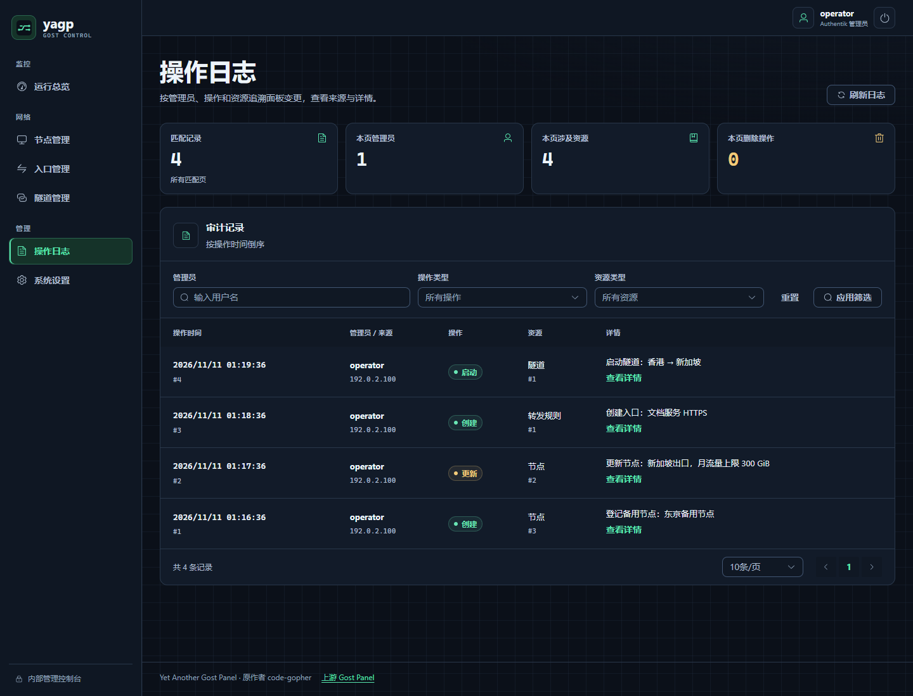
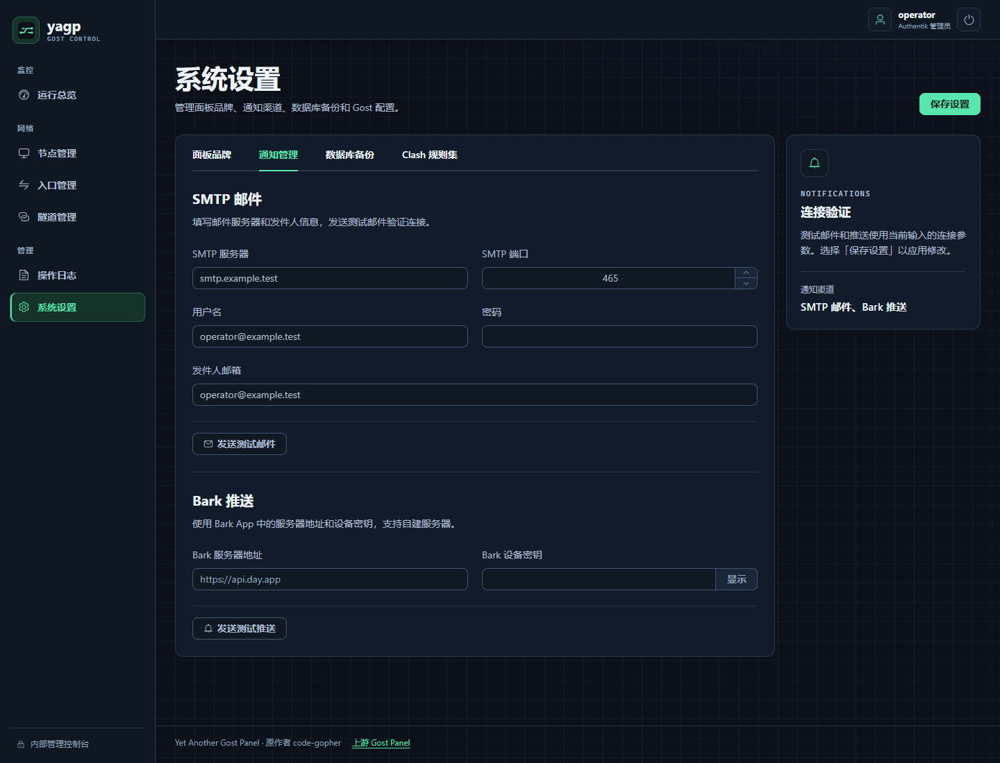

# yagp — Yet Another Gost Panel

集中管理多个 Gost v3 节点、转发规则、多跳隧道和流量配额。

基于 **code-gopher** 开发的 [Gost Panel](https://github.com/code-gopher/gostPanel)，沿用 [MIT 许可证](./LICENSE)。项目改造使用了 OpenAI Codex 辅助，详见 [AGENTS.md](./AGENTS.md)。

## 部署面板

### Docker Compose

需要 Traefik 3.4+（启用 Docker provider）和 Authentik Outpost。将面板域名指向 Traefik 并配置 HTTPS。Traefik 须加入指定的 Docker 网络，并能访问 Outpost。

在部署目录创建 `.env`。Outpost 地址末尾省略 `/`。

```dotenv
YAGP_PUBLIC_HOST=panel.example.com
TRAEFIK_PUBLIC_NETWORK=traefik
TRAEFIK_PUBLIC_HTTPS_ENTRYPOINT=websecure
AUTHENTIK_OUTPOST_URL=http://authentik-server:9000
```

```bash
docker compose up -d
```

编辑 `config/config.yaml`，完成 [Authentik 正向认证](#authentik-正向认证) 和[节点接入](#启用节点注册和流量上报)，然后执行 `docker compose restart yagp`。在其他目录用 `-f` 启动时，将 `PWD` 设为部署目录。

默认镜像为 `release.hanzec-overseas.cn/images/yagp:latest`（Linux amd64、arm64）。固定版本可在 [docker-compose.yml](./docker-compose.yml) 中替换标签。配置、数据和日志分别保存在部署目录的 `config/`、`data/` 和 `logs/`。

Compose 通过 Traefik 的 `yagp-compress` 中间件启用 gzip，压缩面板页面、静态资源和 API 响应。客户端需支持 gzip，响应达到 Traefik 默认的 1024 字节阈值才会压缩。已有部署需更新 `docker-compose.yml` 后执行 `docker compose up -d yagp`，仅升级镜像不会更新这些标签。

### Linux 二进制

在项目根目录以 root 执行。需要 systemd 和大于 128 MB 的内存。默认监听 `39100`，配置位于 `/etc/gost-panel`，服务为 `gost-panel.service`。安装后配置下文的认证与节点接入。

```bash
bash scripts/install_panel.sh
# 指定端口
bash scripts/install_panel.sh install --port 8080
# 卸载，保留配置和数据库
bash scripts/install_panel.sh uninstall
```

### Authentik 正向认证

1. 创建 Proxy Provider，模式选 **Forward auth (single application)**，External host 填面板的 HTTPS 地址。将应用授权给管理员组（如 `yagp-admins`），并分配给所用的 Outpost。
2. Compose 已配置 ForwardAuth 和 `/outpost.goauthentik.io/` 路由。二进制部署需在反向代理配置这两条路由，保留 `Host` 和 `X-Forwarded-Proto`，用认证响应覆盖 `X-Authentik-Username` 和 `X-Authentik-Groups`。 [Authentik 的 Traefik 配置](https://docs.goauthentik.io/add-secure-apps/providers/proxy/server_traefik/)
3. 在面板配置中填写管理员组和代理连接面板时的源 IP。Compose 部署填写 Traefik 在共享网络上的 IP，保持入口的 `forwardedHeaders.insecure` 关闭。

```yaml
authentik:
  trusted_proxies: ["172.30.0.2"]
  admin_group: "yagp-admins"
```

登录后遇到 401 或 403，可用 `docker compose logs --tail 50 yagp` 查看 `auth_failure`、`remote_addr` 和 `authentik_groups`。

### 数据库

默认使用 SQLite。在 **系统设置 → 数据库备份** 中可立即备份或开启自动备份。使用 Docker 时，先在 `yagp` 服务的 `volumes` 中添加 `${PWD:-.}/backups:/app/backups`，再执行 `docker compose up -d`，以便容器重建后仍可访问备份。

使用 MySQL 时，先创建数据库并授予面板账号读写和建表权限，再通过配置文件或 `YAGP_DATABASE_TYPE`、`YAGP_DATABASE_DSN` 设置连接。MySQL 由数据库服务备份。

```yaml
database:
  type: mysql
  dsn: "yagp:<password>@tcp(mysql.internal:3306)/yagp?charset=utf8mb4&loc=Local"
```

节点地区使用独立的 `data/server-country.mmdb` 文件。面板每次启动先加载有效本地库，再在后台重新下载并校验数据库；更新失败时继续使用已有有效库。`geoip.download_url` 可指定 `.mmdb` 文件直链，留空使用默认地址。启动日志会打印本地库状态和下载结果。没有可用库时，节点查询回退到旧版 GeoJS 在线查询并记录 warning；API 请求不会等待或触发数据库下载。

## 节点接入

### 启用节点注册和流量上报

节点通过 HTTPS 和 WebSocket 访问面板的 `443` 端口。配置节点接口的监听地址。留空会停用节点接入。

**Docker Compose** 在 `config/config.yaml` 中设置 `report.listen`。Traefik 将节点接口转发至内部端口 `39101`，节点使用 `.env` 中的 `YAGP_PUBLIC_HOST`。

```yaml
report:
  listen: ":39101"
```

多个节点共用出口 IP 时，可在 `.env` 中调高 `YAGP_REFRESH_RATE_PER_MINUTE`、`YAGP_REFRESH_RATE_BURST`、`YAGP_CONNECT_RATE_PER_MINUTE` 和 `YAGP_CONNECT_RATE_BURST`。若 Traefik 前面还有代理，让前置代理用真实客户端 IP 覆盖 `X-Real-IP`，并将该代理加入 `forwardedHeaders.trustedIPs`。

**二进制直连** 将 `host` 设为节点可访问的面板域名或 IP，开放 `443`，并在入口对注册、刷新和建连限速。

```yaml
host: "panel.internal.example"
report:
  listen: ":443"
  direct_tls: true
```

使用自签证书时，备份自动生成的 `data/report-tls.pem`，避免已有节点失去信任。自备证书时在 `report` 中填写 `cert_file` 和 `key_file`。

**腾讯云 EdgeOne** 开启 HTTP/1.1 WebSocket、HTTPS 回源和源站证书校验，透传 `/api/node/v2/` 及握手中的 `Authorization`，将 WebSocket 空闲超时设为 120 秒。

### 安装新节点

在 **节点管理 → 添加节点** 创建节点，复制面板生成的命令并以 root 执行。每台 Linux 主机安装一个节点，支持 systemd 和 OpenRC。注册令牌有效期为 15 分钟，注册成功或重新签发后失效。

下列命令中的 `RELEASE_TAG` 使用当前面板的发布标签，域名和令牌使用面板提供的值。

```bash
version='RELEASE_TAG'
curl -fsSL "https://raw.githubusercontent.com/hanzec/yagp/refs/tags/${version}/scripts/install_node.sh" \
  | YAGP_DAEMON_VERSION="$version" bash -s -- --host 'panel.example.com' --token 'TOKEN_FROM_PANEL'
```

私有 CA 签发的面板证书需要在安装前将 CA 放到 `/etc/yagp-daemon/panel-ca.pem`，或用 `YAGP_PANEL_CA_FILE` 指定路径。可用 `YAGP_GOST_VERSION` 指定 Gost 稳定版标签。验证 Gost 发布包仍需直连 GitHub API。 [节点安装脚本](./scripts/install_node.sh)

### 升级已安装节点

节点清单显示已安装的 Gost 版本。在节点详情的 **版本与升级** 中可手动将 Gost 升级到最新稳定版，面板在确认升级后查询版本。`yagp-daemon` 跟随面板版本，支持手动和自动升级。在线升级需要 systemd 和可用的系统 D-Bus。

从公网 gRPC 迁移到 WebSocket 时，先备份面板数据库和节点配置，再更新面板及反向代理。节点显示离线后重新签发令牌，以 root 原地注册。把 `42` 换成原节点 ID。迁移保留节点 ID 和 nftables 配置，systemd 服务切换期间转发会短暂中断。

```bash
version='RELEASE_TAG'
curl -fsSL "https://raw.githubusercontent.com/hanzec/yagp/refs/tags/${version}/scripts/install_node.sh" \
  | YAGP_DAEMON_VERSION="$version" bash -s -- reenroll --node-id 42 --host 'panel.example.com' --token 'TOKEN_FROM_PANEL'
```

迁移完成后，可在 systemd 主机上用 `upgrade` 更新守护进程。旧主机若装了多个节点，先卸载多余实例。

```bash
version='RELEASE_TAG'
curl -fsSL "https://raw.githubusercontent.com/hanzec/yagp/refs/tags/${version}/scripts/install_node.sh" \
  | YAGP_DAEMON_VERSION="$version" bash -s -- upgrade --node-id 42
```

systemd 服务启动失败时执行 `journalctl -u yagp-daemon -u yagp-gost`。如实例配置已写入，修复后按脚本提示执行 `update-runtime`。用 `bash scripts/install_node.sh uninstall --node-id <ID>` 卸载节点并保留配置。

## 常用操作

| 操作 | 面板入口与要求 |
| --- | --- |
| 设置流量配额 | **节点管理 → 配置 → 基本设置**。单位为 GB（1 GB = 1,000,000,000 字节），留空或填 `0` 解除限制。周期按北京时间重置，需要支持配额的守护进程和 nftables。**流量校准**使用字节。 |
| 查看节点流量 | **节点清单**和**节点详情**按 GB 显示本期用量和上限。无当期数据时用量显示「未统计」，无上限时显示 `Unlimited`。 |
| 查看实时流量 | **运行总览**。隧道流量按出口 Relay 统计，运行中的旧隧道在下次启动后开始采集。 |
| 查看或重启 Gost | **节点详情 → Gost 服务**。需要 systemd 版守护进程，重启会中断活动连接。 |
| 查看 nftables | **节点管理 → 配置 → nft 配置**。新版守护进程支持在线预览，旧版显示上次保存的规则。 |
| 限制 Relay 来源 IP | **隧道管理 → 更多 → Gost IP 白名单**。选取允许连接的来源节点，清空选择可解除限制。 |
| 订阅 Clash 规则集 | **系统设置 → Clash 规则集**。填写 HTTPS 链接，支持 `payload:` YAML 和文本规则集。 |
| 配置 SMTP 和 Bark | **系统设置 → 通知管理**。测试使用当前表单参数，确认后保存。SMTP 465 使用隐式 TLS 1.2+，私有 CA 须加入面板运行环境的系统信任库。 |

创建双节点隧道时，先在 **端点管理** 为 A 创建**入口**，设置 TCP/UDP 协议和监听地址；为 B 创建**出口**，设置监听地址，并在 **目标与策略** 中选择隧道协议、目标类型、固定目标地址和负载均衡。目标与策略随出口保存，入口无需填写目标。隧道协议用于 A 到 B 的 Relay 连接，入口保留自己的监听协议。

隧道可选 TCP、MTCP、TLS、MTLS、WS、MWS、WSS、MWSS、H2、H2C、gRPC、PHT、PHTS、KCP、QUIC、H3、OHTTP 和 OTLS。KCP、QUIC 和 H3 使用 UDP 监听端口。原有裸 UDP 通道选项用于兼容旧配置，在 Gost v3.3.3 的 Relay 回环验证中转发超时。[Gost 协议概述](https://gost.run/tutorials/protocols/overview/)

选择协议后展开 **高级参数**，可配置该通道的路径、保活、缓冲区、TLS、KCP 或 QUIC 等选项。每个字段标明作用于入口连接、出口监听或两端。留空使用 Gost 默认值，切换协议会清除旧协议的参数。已有未绑定端点的旧隧道可在 **隧道管理 → 编辑隧道** 配置。

例如用 WSS 校验出口身份时，在出口节点部署证书和私钥，填写对应的节点绝对路径，再设置入口使用的 TLS 服务端名称并启用证书和域名校验。使用私有 CA 时，在入口节点部署并填写该 CA 文件。启用双向校验还需要出口的客户端 CA 和入口的客户端证书及私钥。[Gost TLS 设置](https://gost.run/tutorials/tls/)

在 **隧道管理** 选择不同节点上的入口和出口，即可查看出口配置并建立隧道。要调整已绑定出口的目标、策略或协议，先停止隧道，再到端点管理编辑出口，重新启动后生效。升级时已有绑定端点会自动分配入口/出口方向，并将原隧道目标与协议迁到出口；未绑定的旧端点保持原有行为，可编辑后指定方向。

目标可填写域名或 IP 与端口，例如 `example.com:443`。客户端使用 HTTPS 时，Gost 会透传客户端发送的 SNI，无需额外开启；填写目标域名不会改写客户端的 SNI，也不会额外包裹一层 TLS。

出口节点通过 IX 隧道或 NAT 对外提供服务时，在 B 上报地址后打开 **节点配置 → 基本设置 → 监听 IP 映射**。从节点 IP 中选择本机监听 IP，再填写对外连接 IP。新版 `yagp-daemon` 会上报本机网卡地址，包括私网 IP。在 **端点管理** 为 B 选择这组映射的本机监听 IP。若映射为 `10.0.0.2 → 203.0.113.20`，端口为 `8443`，B 上的 Gost 监听 `10.0.0.2:8443`，A 上的 Gost 连接 `203.0.113.20:8443`。

也可将 A 入口配置为 TCP、`127.0.0.1`，在 B 出口的 **目标类型** 中选择 **Clash 规则集** 做透明分流。规则集选项随出口保存，透明接管仍在入口节点执行，入口需要新版 `yagp-daemon` 和 nftables。Gost 监听和链就绪并保存后，守护程序才启用 IPv4 TCP 80/443 重定向。检测到 Docker bridge 时，规则也接管这些桥上的流量。命中订阅的连接经过 B，其余从 A 直连。同一节点可运行一条接管 80/443 的透明隧道。

节点会避开现有 nftables 规则占用的 mark，并在启动时检查和加载已保存的规则版本。升级旧 systemd 节点后，可从节点详情执行运行环境更新以启用 nftables 开机加载。已有透明隧道在下次启动时接入自动管理。若仍加载手工配置的 `inet gost` 重定向表，先停用该配置再启动隧道。

停止或删除被隧道占用的端点时，先操作对应隧道。删除失败时，端点记录会保留，可排除故障后重试。

## 自动部署面板

适用于使用 Traefik Docker bridge 网络和 systemd 247+ 的 Compose 部署。将 Cosign 3.1.3+ 安装到由 root 管理的目录。 [Cosign 安装说明](https://docs.sigstore.dev/cosign/system_config/installation/)

为 Traefik 固定内网 IP，启用 file provider 的 `watch`，并将动态配置目录绑定到宿主机上由 root 管理的目录。安装脚本默认查找容器内的 `/etc/traefik/dynamic`，其他目录用 `--traefik-dynamic-dir` 指定。

将示例中的部署目录和 Traefik 容器名换成实际值。

```bash
tmpdir=$(mktemp -d /tmp/yagp-deploy.XXXXXXXX) &&
  cd "$tmpdir" &&
  curl -q -fsS --connect-timeout 10 --max-time 30 -o setup_deploy.sh \
    https://raw.githubusercontent.com/hanzec/yagp/refs/heads/master/scripts/setup_deploy.sh &&
  sudo bash ./setup_deploy.sh install /opt/yagp-panel --traefik traefik-public
```

未绑定动态目录时，按安装提示将生成的 `traefik-panel.yml` 加入 Traefik 实际读取的目录。从旧版迁移时重跑安装命令，并从动态目录移除旧的独立升级路由。

在 GitHub 的 **production** Environment 中限制 `master` 部署，并填入安装脚本输出的 `DEPLOY_WEBHOOK_URL`、`DEPLOY_WEBHOOK_SECRET` 和 `DEPLOY_WEBHOOK_TOKEN`。仓库级 Actions Variable `YAGP_DEPLOY_ENABLED=true` 启用面板自动部署。部署工具可在 **Build and Release** 中勾选 **Upgrade the server's deployment tool** 手动升级。

```bash
sudo journalctl --namespace=+yagp-depoly -u yagp-depoly.service -u 'yagp-update-*.service' -f
```

手动更新工具可运行 `sudo /usr/local/sbin/yagp-update depoly`。手动部署镜像时，向 `sudo /usr/local/sbin/yagp-update compose` 的标准输入传入镜像的 `sha256:…` 摘要。

部署工具直接拉取指定镜像，并在重建前比较当前和目标镜像的发布版本。目标版本较低时跳过重建，版本标签缺失或无效时报告错误。重建读取服务器现有的 `docker-compose.yml` 和 `.env`，通过标准输入指定本次使用的镜像。后续手动执行 Compose 时，镜像仍以该次命令使用的配置为准。

## 下载与开发

面板支持 Linux（amd64、arm64）、Windows（amd64）和 macOS（Apple Silicon、Intel）。节点支持 Linux（amd64、arm64）。 [发布包](https://github.com/hanzec/yagp/releases)

使用 Go 1.27.3 和 Node.js 26.13.0 LTS。运行 `make build` 构建面板和节点守护进程。运行 Go 测试前先构建前端。

```bash
npm --prefix web ci
npm --prefix web run build
go test ./...
```

端点列表 API（`GET /api/v1/rules`）的 `pageSize` 上限为 100。

## 界面预览

[界面设计标准](./docs/ui-design-standard.md)

<table>
  <tr>
    <td align="center"></td>
    <td align="center"></td>
  </tr>
  <tr>
    <td align="center"></td>
    <td align="center"></td>
  </tr>
  <tr>
    <td align="center"></td>
    <td align="center"></td>
  </tr>
</table>

本项目仅供学习与科研使用，请在法律范围内使用。
